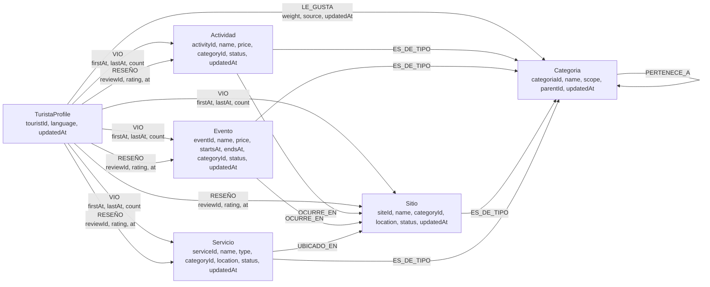

# Modelo lógico Neo4j — ms-05

Actualizado para la decisión **sin `RESERVO`**: las reservas no son una señal de recomendación.
El grafo es una proyección de ms-03, ms-04 y ms-01; no es fuente de verdad.

## Diagrama



No existe la arista `RESERVO`. Tampoco se guardan `reservationId`, `people`, `total` ni
`payment_method` en ms-05.

Una vista (`VIO`) crea o refresca una preferencia **inferida** `LE_GUSTA`
(`source = INFERRED`, `weight = 0.15`) para la categoría del ítem. Una preferencia explícita
(`source = EXPLICIT`, `weight = 1.0`) nunca se degrada por una vista. Así las interacciones
alimentan la afinidad sin usar reservas.

## Etiqueta común `CatalogItem`

Todos los ítems recomendables (`Sitio`, `Actividad`, `Evento`, `Servicio`) llevan además la
etiqueta `CatalogItem` y las propiedades comunes:

| Propiedad | Tipo | Uso |
|---|---|---|
| `itemId` | UUID | identidad común para búsquedas y reseñas |
| `itemType` | `SITE`, `ACTIVITY`, `EVENT`, `SERVICE` | discriminador |
| `name` | string | caché materializada |
| `categoryId` | UUID | categoría principal |
| `siteId` | UUID | sitio al que pertenece; para un sitio, su propio id |
| `latitude`, `longitude` | double | proximidad |
| `status` | `DRAFT`, `PUBLISHED`, `INACTIVE` | filtro |
| `updatedAt` | datetime | novedad y control de versiones |
| `ratingAvg`, `ratingCount` | double, long | calidad materializada desde reseñas |
| `lastReviewAt` | datetime | frescura de la señal |

`Sitio` añade `location: point`; `Evento` añade `startsAt`, `endsAt`, `price`; `Actividad`
añade `price`; `Servicio` añade `type` y `location`.

## Calidad y fairness

La calidad no se calcula con reservas. Se usa el promedio bayesiano:

```text
quality = (C * globalAvg + ratingSum) / (C + ratingCount)
```

- `C` es una constante de suavizado (`quality-prior-count`, por defecto 10).
- `globalAvg` es el promedio previo (`quality-prior-mean`, por defecto 3.5).
- Un ítem con una sola reseña de 5.0 no supera a uno con 200 reseñas de 4.7.
- Las reseñas ocultas o borradas no cuentan.
- La respuesta expone `signals.quality` normalizado entre 0 y 1.

Después del score se aplican topes de exposición:

- máximo 2 ítems por `siteId` en el top;
- máximo 40% de una misma categoría;
- relleno controlado si el catálogo no alcanza el límite.

## Consulta de afinidad

```cypher
MATCH (t:TuristaProfile {touristId: $touristId})-[g:LE_GUSTA]->(liked:Categoria)
MATCH (liked)<-[:PERTENECE_A*0..2]-(c:Categoria)<-[:ES_DE_TIPO]-(item:CatalogItem)
WHERE item.status = 'PUBLISHED'
  AND (item.endsAt IS NULL OR item.endsAt > datetime($now))
  AND ($siteId IS NULL OR item.siteId = $siteId)
  AND NOT EXISTS { (t)-[:`RESEÑO`]->(item) }
WITH item,
     sum(coalesce(g.weight, 1.0)
         * 0.5 ^ (duration.inDays(coalesce(g.updatedAt, datetime($now)), datetime($now)).days / 90.0))
         AS affinity,
     collect(DISTINCT c.name) AS categoryNames
RETURN item, affinity, categoryNames
ORDER BY affinity DESC
LIMIT $candidateLimit;
```

La consulta real devuelve las señales planas que el adaptador mapea a `RecommendationCandidate`;
el score final se calcula en el dominio, no en Cypher. Así se puede testear sin base de datos.

## Consulta de fallback

```cypher
MATCH (item:CatalogItem)
WHERE item.status = 'PUBLISHED'
  AND (item.endsAt IS NULL OR item.endsAt > datetime($now))
  AND ($siteId IS NULL OR item.siteId = $siteId)
  AND NOT EXISTS { (:TuristaProfile {touristId: $touristId})-[:`RESEÑO`]->(item) }
OPTIONAL MATCH (item)-[:ES_DE_TIPO]->(c:Categoria)
WITH item, collect(DISTINCT c.name) AS categoryNames
RETURN item, categoryNames
ORDER BY coalesce(item.ratingAvg, 0.0) DESC, item.updatedAt DESC
LIMIT $candidateLimit;
```

## Constraints e índices

```cypher
CREATE CONSTRAINT turista_id IF NOT EXISTS
FOR (t:TuristaProfile) REQUIRE t.touristId IS UNIQUE;

CREATE CONSTRAINT categoria_id IF NOT EXISTS
FOR (c:Categoria) REQUIRE c.categoriaId IS UNIQUE;

CREATE CONSTRAINT catalog_item_id IF NOT EXISTS
FOR (i:CatalogItem) REQUIRE i.itemId IS UNIQUE;

CREATE CONSTRAINT sitio_id IF NOT EXISTS
FOR (s:Sitio) REQUIRE s.siteId IS UNIQUE;

CREATE CONSTRAINT actividad_id IF NOT EXISTS
FOR (a:Actividad) REQUIRE a.activityId IS UNIQUE;

CREATE CONSTRAINT evento_id IF NOT EXISTS
FOR (e:Evento) REQUIRE e.eventId IS UNIQUE;

CREATE CONSTRAINT servicio_id IF NOT EXISTS
FOR (v:Servicio) REQUIRE v.serviceId IS UNIQUE;

CREATE INDEX catalog_item_status IF NOT EXISTS FOR (i:CatalogItem) ON (i.status);
CREATE INDEX catalog_item_type IF NOT EXISTS FOR (i:CatalogItem) ON (i.itemType);
CREATE INDEX catalog_item_site IF NOT EXISTS FOR (i:CatalogItem) ON (i.siteId);
CREATE INDEX catalog_item_category IF NOT EXISTS FOR (i:CatalogItem) ON (i.categoryId);
CREATE INDEX catalog_item_updated_at IF NOT EXISTS FOR (i:CatalogItem) ON (i.updatedAt);
CREATE INDEX evento_starts_at IF NOT EXISTS FOR (e:Evento) ON (e.startsAt);
CREATE INDEX evento_ends_at IF NOT EXISTS FOR (e:Evento) ON (e.endsAt);
CREATE INDEX categoria_parent IF NOT EXISTS FOR (c:Categoria) ON (c.parentId);
CREATE INDEX categoria_scope IF NOT EXISTS FOR (c:Categoria) ON (c.scope);
```

Los IDs son los UUID estables de ms-03/ms-04. No se usa `id(n)` ni `randomUUID()` en ms-05:
un re-sync debe ser idempotente.

## Qué falta para la fase 2

- Consumidores Kafka para `catalog.*`, `activities.*` y `reviews.review.changed`.
- Idempotencia por `eventId` y comparación de `updatedAt`.
- Actualización materializada de `ratingAvg`, `ratingCount` y `lastReviewAt`.
- Reindex desde ms-03/ms-04.
- DLQ y métricas de lag.

`bookings.reservation.changed` no se consume en ms-05.
